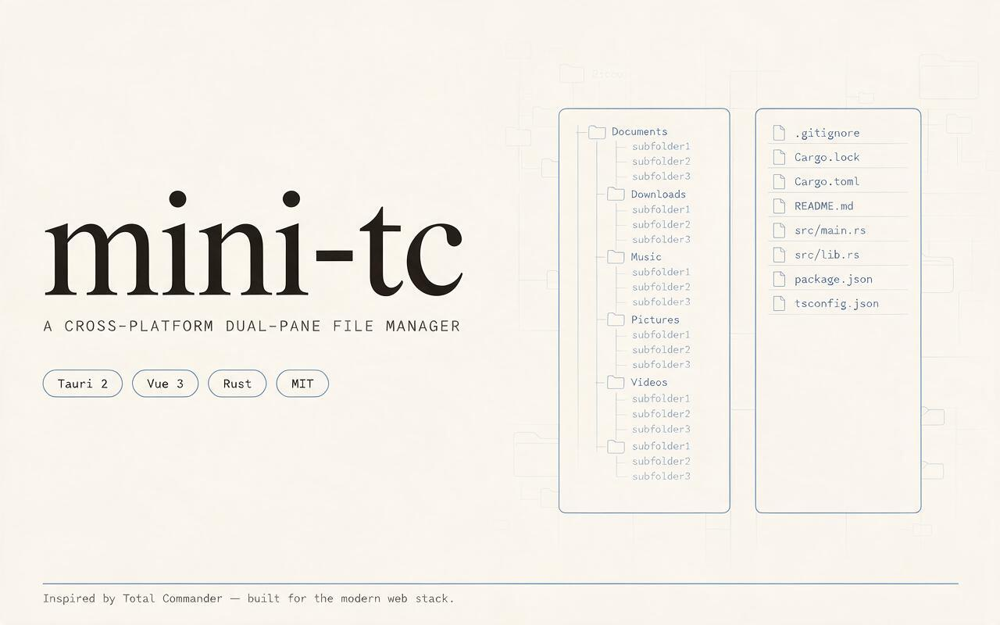

# mini-tc

<p align="center">
  
</p>

<p align="center"><em>基于 Tauri 2 + Vue 3 的跨平台双栏文件管理器，致敬 Total Commander。</em></p>

---

## 功能

- 左右双栏布局，可拖拽调整面板宽度（比例会被记住，下次启动保持，双击分隔条复位）
- 每栏独立多 Tab 管理，Tab 状态自动持久化
- 可编辑路径栏 + 盘符下拉切换
- 文件列表按名称 / 大小 / 修改时间排序（名称排序时：忽略连字符 `-`，如 `-1a.txt` 按 `1a.txt` 比较；中文字符排在数字与英文字母之后，如 `0.txt` < `a.txt` < `推特.txt`；数字段按数值自然排序，`1a.jpg` < `2c.jpg` < `10b.jpg`）
- **启动屏（splash）**：冷启动时全屏 logo + 三点循环加载。splash 是 `index.html` 里的**静态元素**，几乎立刻绘制，加载工作在其下**并行**进行——它的职责是让等待可见，所以**工作一完成就必须立刻让位**。判定条件是「展示时长 ≥ 250ms（防一闪）**且** 左右两栏首次列目录都完成」，两者同时满足即淡出（250ms），另有 2500ms 硬兜底防止慢目录/网络盘把用户堵在加载页。⚠️ **计时起点必须取 `index.html` 内联脚本里的 `__MINITC_SPLASH_SHOWN_AT__`，不能取 `main.js` 里的 `performance.now()`**——后者比 splash 实际出现晚约 390ms（模块求值完才执行），MIN_SHOW 会在「早已显示」的基础上再加一段死等（实测白等约 160ms）。常量 `SPLASH_MIN_SHOW_MS` / `SPLASH_FADE_MS` / `SPLASH_MAX_SHOW_MS` 在 `src/main.js` 顶部，其中淡出时长由 JS 在运行时内联写入 `transitionDuration`，是单一真源（`index.html` 里的 CSS 只是兜底，别再两处各写一份）
  - 埋点里 `splash:fade-start` 的 note 现在是 `shown=…ms panels=N after-ready=…ms`：**`after-ready` 才是调参依据**——它表示「数据全就绪后用户还得盯着一个已完成的动画多久」，应当恒为 0；`shown` 只是 splash 总显示时长，别拿它当延迟指标
- **启动耗时埋点**：`src/bootLog.js` + 后端 `boot_mark` / `boot_timings` 命令，开发模式下 devtools 控制台会打印两张 `console.table`（JS 阶段 / Rust 阶段，共用同一时钟可直接对齐），Rust 侧另有 `[boot] ... ms` 逐行输出到控制台窗口。用 `localStorage.setItem("minitc-boot-log", "off")` 可关闭
- **启动路径上的两处瘦身**（实测大头是 Tauri 固有的 WebView2 `setup`，JS 侧能砍的主要是重复探测与无谓排序）：
  - **驱动器列表缓存**：后端 `list_drives` 要遍历 A–Z 逐个 `Path::exists` + 对应答的卷调 `GetDiskFreeSpaceExW`（空光驱、断连网络盘可阻塞数百 ms），而左右两栏在 mount 和**每次窗口重新获得焦点**时都会各调一次 —— 一次切窗就是 4 次走盘。现由后端 `OnceLock<Mutex<..>>` 缓存、TTL 2 秒。**锁要持跨越探测本身**：两栏的请求在同一 tick 发出，只包缓存检查的话它俩会双双 miss 各跑一遍全盘扫描
  - **`list_directory` 不再排序**：前端 `sortedEntries` 对除 `found`（搜索顺序，仅搜索结果伪目录有意义）外的所有列都会重排，后端排的序必被丢弃，而那个比较器每次比较要 `to_lowercase()` 两次 = O(n log n) 次堆分配，故直接删掉
  - ❌ **反例：不要把 9 次 `load_config` 合并成 1 次 `load_configs`**。曾实现并实测为**负优化**——配置总量仅约 4 KB，瓶颈从来不是 I/O 而是 IPC 往返本身：合并后的单次调用要 **57ms**，而被它替代的 9 次并行单文件调用每个只要 ~14ms。把 9 次并行排到 1 道屏障后面，等于让页面上最慢的东西变成那道屏障。这个量级下**并行独立 > 批量串行**。静态分析（「9 次往返合并成 1 次」听起来必然更优）在这里是错的，只有实测能发现量级反了
  - 另：`list_directory` 每条目 stat 两次（→改 `entry.metadata()`）在实现递归搜索时已顺带修掉
- **文件预览**（Ctrl+Q）：文本（txt/md/json/log）、图片（jpg/png/gif/webp/bmp/svg/avif）、HEIC 系列（heic/heif/hif/avci）和 PDF/doc/docx；图片经 asset protocol 直接加载，无大小限制；文本预览区内可拖选文字按 Ctrl+C 复制，或点 footer「复制全部」复制整篇
  - **HEIC/HEIF 预览**：WebView2 无原生 HEIC 解码器，走 `src/heicDecoder.js` + `src/heicDecode.worker.js` —— Worker 里用 **libheif 的 WebAssembly 版**解码成 RGBA，主线程再 canvas 编成 JPEG 交给 ``，图上标注「已转换为 JPEG」。wasm 约 2 MB，按需加载（`?worker` 导入 + `optimizeDeps.include` 登记），启动不受影响。设了两道防爆上限：单文件 60 MB、解码后 5000 万像素（12MP 手机照片约需 48.8 MB RGBA 缓冲）
  - **⚠️ 像素上限必须在 Worker 里 `display()` 之前判**（曾踩坑）：原本上限是在 `decodeHeic()` 返回之后才检查的，可那时 `display()` 早已跑完 —— 实测一张 12240×16320 的文件**先烧掉 4.4 s / 762 MB RGBA / 2.1 GB RSS，然后才弹「已跳过预览」**，上限等于没设。现在上限由 `heicDecoder.js` 的 `MAX_HEIC_PIXELS` 经 postMessage 传进 Worker，在分配像素缓冲前拦截
  - **超大图回退到容器内嵌的缩小版**：超限时先在容器里找同图的内嵌预览，找不到才拒绝。HEIC 的 **grid 派生图**会把这事变成刚需：主图是 N×M 个 tile 拼成的马赛克（每个 tile 是独立的隐藏 item），所以能出现「3 MB 文件装 200 MP」。实测用户那份 `P (3).HEIC` 有 **768 个 512×512 tile 拼成 16320×12240**（`irot` 转 90° 后显示 12240×16320），全量解码要 762 MB；改用 item 770 内嵌的 384×512 缩小版后 **4.4 s / 762 MB → 56 ms / 0.8 MB**。筛选条件：跳过 top-level id、跳过 hidden item（否则会取到拼图碎片）、跳过 `Exif/mime/uri`、像素数 ≥64K 且 ≤上限、**长宽比与主图差 ≤2%**（挡掉深度图 / alpha 平面），多候选取像素最多者，扫描上限 2048 个 item 防病态文件。命中降级时图上标注「原图 WxH 过大，已显示内嵌预览图」
  - **多帧 HEIC 播放（canvas）**：容器里有多个 top-level 图元时（连拍 / 序列 / Live Photo）走动画播放，`<canvas>` + `putImageData` 逐帧绘制（不用 ``：换 src 会闪且每帧泄漏一个 objectURL）。首帧随初始解码一起返回，UI 立即有画面；其余帧**按需向 Worker 索取**（`decodeHeicFrame(index)`），Worker 缓存已解析的容器避免每次重解析（实测 19 ms/次）。**帧率不靠猜**：读每帧的 `heif_image_get_duration()`，真有时序就按真实速度播，只有文件完全没有时序数据时才回落 100 ms/帧。底部有播放/暂停按钮和 `当前/总帧数` 计数；换文件与组件卸载都会停掉循环
    - 🚨 **循环令牌（`animToken`）必做**：`clearTimeout` 只能杀当前那个定时器，若某帧正在 `await` 解码，换文件时它回来后还会继续调 `decodeHeicFrame()`，对着 Worker 里已被替换的容器反复取帧 —— 表现为方向键快速切文件后 canvas 自己乱跳。每次启停递增令牌，旧循环回来一比对即退出。帧解码失败时**结束循环而非空转**，否则卡在同一帧反复报错
  - **为什么不用 heic2any**（已移除）：它内嵌的是 emscripten **asm.js** 版 libheif，YUV→RGBA 转换跑在 JS 解释器上。实测 12MP 手机照片中位数：**asm.js 1047 ms vs wasm 422 ms（2.5x）**。⚠️ `libheif-js` 的 package.json `main` 指向的正是 asm.js 版（`libheif/libheif.js`），必须显式引 `libheif-wasm/libheif-bundle.mjs` 才拿到 wasm
  - **HEIC 耗时诊断**：每次预览在 devtools 控制台打一张折叠表（`[heic] <文件名> <总耗时> ms`），分 `start / file-read / worker-decode / encoded / ready / painted` 六步，**每文件一张**可左右对比。`worker-decode` 的 note 里进一步拆出 `hevc=Xms`（比特流解码）和 `rgba=Yms`（颜色转换）。失败、翻页中断、超限中止三种情况也会补打（末行标 `failed` / `interrupted` / `aborted`）；多帧文件在 `ready` 步显示 `frame 1/N`
  - **⚠️ libheif-js 的 embind 调用约定（实测，别猜）**：高层 `HeifDecoder.decode()` 拿到的 `HeifImage` 有 `.handle`（原生 handle）和 decoder 的 `.decoder`（`heif_context`），可直接调 `heif_item_get_item_type` / `heif_item_is_item_hidden` / `heif_js_context_get_image_handle(ctx,id)` / `heif_image_handle_release`。但**返回 struct 的函数分两类**：`heif_context_read_from_memory(ctx, buf)`、`heif_context_has_sequence(ctx)` 这类已被 embind 封装，正常传参、返回 `{code, subcode, message}`；而 `heif_image_handle_get_image_tiling` / `decode_image_tile` 等裸导出**必须自己 `_malloc` 传隐藏 sret 指针**再从 `HEAP32` 读，少传会静默返回垃圾值而不报错 —— 极易误判成「API 不可用」（grid 分块解码就走不通这条路，只能靠内嵌缩小版绕过）
  - **⚠️ 剩余慢点**：换成 wasm 后 12MP 仍需约 420 ms，**瓶颈依然是全尺寸 YUV420→RGBA 转换**（HEVC 比特流解码只占 2–10 ms）。根治要靠降采样，但 libheif-js 的高层 API 不暴露尺寸参数（C API 有 `heif_image_scale_image`，但如上所述在 embind 下调不通）。后端 Rust `libheif-rs` 有干净的 `HeifDecodingOptions::max_width`，是后续方向
- **视频预览**：`mp4/webm/ogv/mov/m4v` 等由 WebView 直接解码（含字幕自动探测同目录 `srt/vtt/ass`、外挂字幕、±0.5s 偏移微调、倍速、音量记忆）；`mkv/avi/flv/wmv/rmvb` 等无法解码的格式自动回退「用系统播放器打开」，HEVC/H.265 这类「有声音没画面」的情况也会自动识别并回退。控制栏中**进度条常驻**（随时可见当前位置、可拖动 seek），仅下方按钮行在播放 3 秒后自动收起，鼠标移回底部或暂停时立即恢复
  - **预览时窗口置顶**（配置 → 通用设置，**默认关闭**）：开启后播放视频预览时 MiniTC 窗口保持在所有窗口之上，关闭预览（Esc / 切换到别的文件 / 关掉面板）后自动还原层级。⚠️ 置顶是**操作系统窗口级**属性，所以浮起来的是**整个 MiniTC 窗口**（含文件列表），不是只有视频画面那一块——浏览器没有任何 API 能把单个 DOM 元素抬到其他程序窗口之上，想做到「只有视频浮在最上层」必须把播放器拆成独立的置顶窗口。置顶联动由一个 `watch` 驱动 `src/alwaysOnTop.js`（对 ↑/↓ 切片、面板切换、自动连播、Esc 全部自动生效，且做了状态去重与失败回滚），退出时强制还原以免留下置顶窗口。
- **通用设置**（配置 → 通用设置）：应用级配置项的独立页面，与「文件预览设置」（只管单个文件怎么渲染）和「快捷键设置」并列。配置项以声明式 schema（`GeneralSettingsDialog.vue` 顶部的 `GROUPS` 数组，分组 + 行，行类型 `toggle` / `select`）声明，新增一项只需加一个对象，UI 渲染 / 持久化 / 缺省回退自动获得。按 key 前缀分流存储：`view.*` 开头的行归 `viewState.js`（`~/.minitc/view-state.json`），其余归 `~/.minitc/app-config.json`，所以对话框不必知道某行属于哪个 store
- **视图状态持久化**（`~/.minitc/view-state.json`，模块级单例 `src/viewState.js`，150ms 防抖写盘）：记住「文件列表长什么样、怎么排」这类偏好，重启后自动恢复
  - **显示隐藏文件**（`Ctrl+H`，或通用设置 → 视图里左/右栏各自一个开关）：默认**不显示**点开头的名称与隐藏/系统属性文件。后端始终全量返回，过滤纯在前端做，所以切换是**瞬时**的（上万项的目录也不会重新列目录）。**左右栏独立**——双栏本来用于对比，「左边看点文件、右边看干净的」是正当诉求。显示出来的隐藏文件仍保持半透明（不然看着像 bug）。⚠️ 过滤会整体平移行号，故选中集合按**条目对象身份**（不是下标）迁移到新列表——否则切换时第 3 行的选中会静默变成另一个文件，而它正是预览/重命名/删除的操作目标
  - **列宽可拖拽**：Name / Size / Type / Modified 四列表头右侧都有手柄，拖动实时改变宽度，**双击手柄恢复该列默认宽度**；写盘防抖，所以拖动过程不会每帧写一次。列宽**左右栏共用**（300px 的 Size 列在两栏是同一件事，分开只会像 bug）。四列宽度都是**字面宽度**，面板多出来的空间留成右侧空白（与资源管理器一致），所以拖出来的宽度在任何面板宽度下都保持原样——Name 列也是可调的，长文件名被截断时可以直接拉宽
  - **窗口缩小时的降级优先级**：**Size / Type / Modified 优先保证完整显示，文件名栏承担全部让步**（缩窄→ 省略号 → 归零），因为文件名在地址栏还能看到，而被截掉的时间列丢的是用户明确设过的信息。面板宽到连三栏都放不下时，三栏才按同一比例等比缩小（各自有可读下限：Size 60 / Type 48 / Modified 96），并且 Name 先归零。**这些都是渲染时的临时调整，存储的设定值一个字节都不动**——窗口拉回去立刻恢复原样。拖拽起始宽度取的是**存储值**而非实测宽度，否则窗口缩小后 Name 会被永久卡在挤扁后的尺寸、再也拖不宽
  - **新标签页默认排序**：新建 tab 时按此处的列 + 方向打开。**故意不追溯重排已有 tab**——每个 tab 的排序存在自己的 `tabs-<id>.json` 里，用户已经摆好的 tab 被静默重排是惊吓
  - **预览开关**：退出时开着预览（图片/文本/视频）则**重启后自动恢复**，并把源列表设为活动栏、重新选中该文件，于是 Esc / Ctrl+Q 的行为与「从未关闭过预览」完全一致。文件在关闭期间被删则跳过恢复。「格式不支持」占位页不恢复（没有内容可显示）。恢复会等两栏都完成首次列目录，避免预览盖住空面板
  - 配置被改坏也不会出问题：列宽按上下限夹取、非有限值落回默认，排序列必须是已知键，损坏的 JSON 只丢该项、其余照常生效
- 4 套内置主题（石墨工业 / 霓虹暗夜 / 暖茶拿铁 / 墨竹青翠）
- **Tab 切换左右面板**（与 Total Commander 一致）：焦点在文件列表时按光标 `Tab` 即在左/右栏之间跳转，切换后键盘焦点交给新面板，方向键直接接着操作。焦点不在文件列表上（地址栏 / 文件名过滤 / 内联改名 / 对话框 / 右键菜单）时 `Tab` 保持浏览器的原生焦点切换行为不被抢走
- **多标签页快捷键**（与 Total Commander 一致）：`Ctrl+T` 在**当前活动面板**按当前目录新开一个标签页，`Ctrl+W` 关闭该面板的当前标签页（仅剩一个时无操作，不会把最后一栏关掉），`Ctrl+Tab` / `Ctrl+Shift+Tab` 在该面板的标签页之间**轮换**（到底后回到第一个，环绕不卡住）。四者都在地址栏 / 文件名过滤框获得焦点时同样生效，且执行后键盘焦点自动交回文件列表，方向键可直接操作新标签页。轮换成功时会弹一条 toast 报出落点路径；只有一个标签页时静默忽略。左右栏各轮各的，互不影响
- **标签页锁定 / 一键回到锁定位置**（对应 TC 的「锁定，但允许更改文件夹」）：`Ctrl+Shift+L` 把当前标签页的所在目录记为**锁定锚点**（已锁定时再按一次解除），`Ctrl+Y` 把该标签页跳回锚点。⚠️ 锁定**不阻止目录切换**——标签页仍可自由进出任何目录，锁定的只是「回家的路」，这点与 TC 一致（TC 另有 `Ctrl+Num*` 的严格锁定，即禁止换目录，本应用未实现）。标签栏上已锁定的标签显示 🔒 并染上淡色底，悬停提示里同时给出当前路径与锁定路径；**在标签页上右键**弹出菜单：锁定当前位置 / 回到锁定位置 / 以当前目录重新锁定 / 关闭此标签页。锁定锚点随标签页一起持久化到 `~/.minitc/tabs-<panelId>.json`，重启后依然有效（旧存档无该字段即视为未锁定）
- **选中态跟随文件而非行号**：选中项在列表里按**条目身份**记住，不是按行号。所以改变排序（点列头）或用 `/` 过滤之后，选中的仍是**同一个文件**而不是「原来那一行」——不会出现「选中 A、排序后按 Delete 删掉 B」。若选中的文件被过滤掉或目录内容刷新，选中态一并清空，不会错落到别的文件上。改名（F2）进行中同样跟随条目，不会跳到别的行。
- **导航前进 / 后退**（`Alt+←` / `Alt+→`，浏览器式）：每个标签页维护**自己独立**的目录历史栈，左右栏、各标签页互不干扰（与 TC 的每面板历史一致）。历史栈随标签页一起持久化到 `~/.minitc/tabs-<panelId>.json`，**重启后仍能往回走**；每档上限 100 条，超出丢弃最旧的。地址栏上有 `←` / `→` 两个按钮可点，无历史可走时置灰但不隐藏（避免工具栏跳动），tooltip 说明原因。
- 标准 history 语义：新导航会**截断前进分支**（往回走两步后走进新目录，原来的「前进」就没了）；后退 / 前进回到某个目录时会**顺带选中刚离开的那个文件夹**，与浏览器一致。已删除的目录（或已拔掉的盘）在回退途中会被**自动从栈里剔除**并继续往更早的方向找，不会把面板卡在报错页——剔除了几个会弹 toast 说明。
- **鼠标侧键同义**：XButton1（后退）/ XButton2（前进）走的是同一套历史栈，**不再是「返回上一级」**——上一级仍由 `Backspace` / 双击 `..` 负责，两者语义不再混淆。仅活动面板响应。
- **目录书签 / 常用目录**（`Ctrl+D`）：把当前目录收进一份**全局共用**的常用目录列表，一键跳回深层路径，不用每次逐层点进去或临时开标签页。地址栏上的星标按钮打开下拉，点击书签即跳到**当前活动面板**；`Ctrl+D` 是开关式——加了再按一次就移除，并弹 toast 报出结果。星标用 `☆`（空心、暗色）/ `★`（实心、主题色 + 同色边框）区分是否已收藏，**刻意不用 `⭐` emoji**：emoji 由彩色字体渲染成固定图形，`color` 对它无效，未收藏时也会一直显示成黄色。
  - 书签**有名字**，可在下拉里**行内改名**（回车提交 / Esc 取消），**右键**书签行弹出菜单重命名 / 上移 / 下移 / 删除；底部另有「添加当前目录」按钮，不记快捷键也能操作。**左右栏共用同一份列表**（模块级单例 + `~/.minitc/bookmarks.json`），任一栏加的书签另一栏立刻可见，且不占用任何标签页。
  - 与「标签页锁定」（`Ctrl+Shift+L`）是**两件不同的事**：锁定是「这个标签页记住一个回家的锚点」，锁完照样能自由浏览；书签是「全局一份带名字的常用目录」，不绑任何标签页。搜索结果标签页是虚拟目录，既隐藏 `⭐` 也不响应 `Ctrl+D`（快捷键直接落空，不被吃掉）。
  - **失效书签自动置灰**：目录被删或盘符被拔时，行内加删除线并在悬停提示里标明「目录已不存在」；点击时还会再验一次，宁可弹 toast 报错也不会把面板带进报错页。
  - **「最近访问」分区**列出本标签页最近走过的目录（倒序，最多 10 条，不含当前目录）。它**不额外落盘**，而是从该标签页自己的历史栈现算——历史栈已经持久化并且本来就在驱动 `Alt+←`，另存一份只会跟它不一致。
  - 两个面板各有一个下拉，共享一个「当前展开者」令牌，保证同时只会展开一个，不会出现两个下拉各带一层遮罩。菜单的 mousedown / Esc 监听走 **capture** 阶段（否则面板根节点的 `@click` 会抢先激活面板），Esc 还会 `stopPropagation` 以免连带触发「关闭预览」。
- **搜索结果标签页没有历史**：`minitc://search/{id}` 哨兵不是真实目录，按钮直接隐藏；从结果集跳进真实目录时**重新起一段历史**（不会把哨兵记成可回退的一站）。
- **右键上下文菜单**：在空白处右键可「新建目录」（在当前目录创建空文件夹，创建后可直接改名）；在文件/文件夹上右键可「打开」「复制路径」；对压缩包（zip/rar/7z/tar/gz/iso…）自动探测本机已安装的 **7-Zip / WinRAR / unzip**，提供「解压到当前文件夹」「解压到同名文件夹」入口，解压后自动刷新面板；**多选多个压缩包时按顺序逐个解压**（菜单标签显示「依次解压 N 个」，图形界面工具会等上一个窗口结束再启动下一个，不会一次弹出 N 个窗口），失败的压缩包在汇总提示里列出文件名，成功的部分照常生效
  - **可执行目标额外有「以管理员身份运行」**（Windows，弹 UAC），与资源管理器同名菜单对齐。**是否显示由后端按内容判定，不是只看扩展名**：`.exe`/`.com`/`.scr` 要真的读出 `MZ` + `PE\0\0` 头（改名成 `.exe` 的文本文件不会被误当成可运行目标），`.bat`/`.cmd`/`.ps1` 要真有可执行命令行（全注释的脚本壳不给这个入口），`.lnk`/`.msi`/`.msp` 按扩展名放行（快捷方式由 shell 自己解析目标，安装包要走 msiexec）。**刻意不查注册表的文件关联**——那会让所有注册了 `runas` 动词的文档类型都冒出这一项，既昂贵又让人意外。
  - 启动方式按类型分派：`.bat/.cmd` → `cmd /c`，`.ps1` → PowerShell，`.msi/.msp` → `msiexec /i|/p`，其余直接启动；**工作目录设为文件所在目录**（不少 exe 靠相对路径找同目录资源）。只作用于右键点的那一行，不作用于整个多选集合；**已标记剪切（`Ctrl+X`）的行该菜单置灰**——对「即将被移走的文件」提权运行语义混乱，且提权起来的那份会在移动完成后继续运行。非 Windows 平台该菜单项不出现。拒绝 UAC 只提示「已取消管理员权限请求」，不当作错误。
- **复制 / 剪切 / 粘贴**（Ctrl+C / Ctrl+X / Ctrl+V）：与系统剪贴板双向互通（Windows `CF_HDROP`，可与资源管理器互拷），支持多选批量与跨卷移动，拷贝过程带进度条；目标存在同名项时可选「跳过 / 覆盖」。
  - 覆盖策略（防数据丢失 + 目录合并）：同名**文件夹**冲突时采用**合并**（merge）而非整目录替换删除——例如把 `root/a/a` 移动/拷贝到 `root/`，其内容会并入已存在的 `root/a`（移动后 `root/a/a` 自身被清空移除），不会误删数据；同名**文件**冲突才按覆盖/跳过处理。仍拒绝真正危险的操作：把目录移动到自身内部（`root/a` → `root/a/b`）。
  - **「是否合并目录」与「是否覆盖文件」是两个独立决策，不共用一个开关**。移动到已存在的同名目录**必须**合并（`rename` 到非空目录不可能，整体替换会丢数据），但合并进去的每一层里遇到同名**文件**时，仍然尊重你在冲突框里的选择：选「跳过」就保留目标侧原文件、选「覆盖」才替换。早先这两件事共用一个 `overwrite` 参数，为了拿到目录合并只能传 `true`，那个 `true` 于是顺着递归漏到每个叶子冲突上，把「不覆盖」顶掉了——这会在你明确选择保留目标文件时把它删掉换成源文件。
  - **只有「整棵树完整无冲突地搬走」的源才会被删除**。判据是一份白名单（`copy_all` 回报的 `moved_sources`）而不是「没报错就删」：用户选择「不覆盖」产生的是**静默的跳过**，不产生任何错误信息，用「错误列表为空」当判据会把从未写到目标的文件删掉。任何被跳过、被占用、复制失败的源都会被保留，并在结果里如实列出「`X` 未完全搬走 / 未完全合并，已保留源文件 / 源目录」，由你决定后续怎么处理。
  - **不跟随符号链接与目录联接，遇到即跳过并提示**。复制/移动时若源里包含符号链接（symlink）或目录联接（junction），**这些条目会被跳过**，并在结果里明确列出跳过了哪些。**不支持复制链接本身** —— 目标位置不会出现联接，也不会出现空目录。
    - **为什么不跟随**：`Path::is_dir()` 会跟随链接、对联接返回 `true`，于是一个指向自身祖先的联接会让遍历无限自我嵌套（实测 `loop\loop\loop\…`）。Windows 只在路径超过 `MAX_PATH`（约 260 字符、约第 31 层）时兜底终止，所以**不会崩，而是复制出约 30 层幽灵目录并报告成功** —— 这是数据损坏。
    - **为什么不复制成普通目录**：那会在链接原本的位置留下一个**空目录**，看起来像复制成功而内容全无，比报错更糟。
    - **为什么不重建链接**：技术上可以（`FSCTL_SET_REPARSE_POINT`），但需要手工拼装 reparse 数据缓冲区，写错只会得到一个无从诊断的 `ERROR_ACCESS_DENIED`。该场景罕见，不值得为此承担风险 —— **如实跳过优于给出一个可能 subtly wrong 的结果**。
    - 另有 64 层深度上限（与搜索一致），触顶会明确报错而不是静默截断，因为静默截断在移动时会导致源侧未复制的尾巴被删除。
- **F5 复制到对面栏 / Shift+F5 移动到对面栏**（与 Total Commander 一致）：把**当前活动面板**的选中项直接送到**对面面板当前所在的目录**。与 `Ctrl+V` 是两条独立的路——`Ctrl+V` 只认系统剪贴板，F5/Shift+F5 完全不碰剪贴板（连复制都不写剪贴板），源目录与目标目录可以在任意两个盘符之间。执行后两个面板都自动刷新，键盘焦点留在**源面板**，可以继续按方向键操作原选中项。
  - 目标已有同名项时复用粘贴的冲突确认（跳过 / 覆盖），目录冲突同样是**合并**而非替换删除
  - 与拖拽一致地跳过无意义项：已经直接躺在目标目录里的文件不会被「移动到自身所在目录」
  - 两栏停在同一目录时直接提示「对面栏与当前栏在同一目录」，不做自我复制
  - 与其他 `F*` 快捷键（`F2` 重命名）一样可在**配置 → 快捷键设置**里改键；焦点在内联改名输入框内时 F5 不生效（那是文本框）
- **鼠标拖拽移动**（跨应用、跨进程）：直接用鼠标把文件/文件夹（单个或 Ctrl/Shift 多选集合）拖到目标文件夹、空白区（= 当前目录）或「..」（= 父目录）即可移动到该目录；支持**跨栏拖拽**（从左栏拖到右栏目录），**也支持直接拖到资源管理器 / QQ / 7-Zip 等外部应用**——接收方拿到的是真实文件（Windows 走 `CF_HDROP` + `Preferred DropEffect=DROPEFFECT_MOVE`，macOS 走 `NSFilenamesPboardType`），行为与从资源管理器拖出完全一致；外部往 mini-tc 拖入的文件则按复制（copy）处理，落到文件行上忽略。落点高亮提示，移动/复制后自动刷新源栏与目标栏，冲突处理与同名项合并策略复用粘贴逻辑。
  - ⚠️ **依赖 `tauri-plugin-drag`（CrabNebula 维护的 drag-rs）**：前端在文件行 `dragstart` 时调用 `startDrag({ item: 绝对路径, mode: 'move' })`，Rust 后端走 Windows 的 OLE `DoDragDrop` / macOS 的 `NSPasteboard` 直接写出 `CF_HDROP` / `NSFilenamesPboardType`。预览图标故意传一个无法解码的字节（0x00），让 drag-rs 跳过 `IDragSourceHelper::InitializeFromBitmap`，由 OS 从 `CF_HDROP` 自动渲染文件图标（多文件显示「多文件缩略图 + 数量」），行为与资源管理器完全一致；如果传了真实图标则会覆盖 OS 默认渲染，反而不如默认直观。Linux 下 drag-rs 需 GTK 应用窗口（winit 类不支持），跨进程拖出会失效，本项目不针对 Linux 保证。`dragDropEnabled: true` 让 Tauri 接管 webview 拖放，配合 `tauri://drag-enter / drag-over / drag-drop / drag-leave` 事件拿到光标坐标 + 文件路径；前端 `elementFromPoint(x, y)` 反推落点（目录行 / `..` / 空白区 / 文件行），自拖自时走 move（cut），外部拖入时走 copy。
- **递归文件搜索**（`Alt+F7`，`Ctrl+F` 同效，与 Total Commander 一致）：在任意根目录下按文件名递归查找，可在**当前活动面板**中直接跳转到结果所在目录并选中该文件。
  - 文件名语法沿用 TC：**分号分隔多个模式**（`*.txt;*.md`）、`*`/`?` 通配符、**不含通配符的普通词按「名字包含」匹配**、留空则列出全部。另有「区分大小写」「包含隐藏文件」两个开关。
  - 可选**内容搜索**：只保留文件内容里包含指定文字的条目；自动跳过二进制（前 4KB 含 NUL 字节）和大于 8MB 的文件，避免扫大文件拖慢整个遍历。
  - 后端 `start_search` 在**独立线程**里跑，结果以 `search-batch` 事件**分批流式**回传（每 200 条或 200ms 一批）；扫描期间另有 `search-progress`（约每 300ms）实时回传**已扫描条目数**和**当前正在扫描的目录**，状态栏据此显示「正在扫描：…」，不会出现「看起来卡住了其实在跑」；扫描结束发 `search-done`。界面全程可响应，随时可点「停止」取消（`cancel_search` 置标志位，线程在每个条目上检查）。新搜索会自动取消上一次未完成的扫描，旧结果不会串进新列表（每批结果带 `id` 校验）。
  - 结果列表是**虚拟滚动**的（只渲染可视行），上万条也不卡；默认上限 5000 条，达到上限状态栏会提示「结果已达上限」。
  - 双击 / 回车 = 跳转到该文件（对侧是预览时会自动先关掉预览）；右键菜单可「跳转到该文件」「打开所在目录」「复制完整路径」「用系统默认程序打开」。
  - 与 `/` 键的即时过滤是两种东西：`/` 只过滤**当前目录**、轻量即时；搜索面板是**跨目录递归**的重量级查找，两者并存。
  - 遍历只用 `DirEntry::metadata()`（Windows 上直接复用目录扫描已返回的 `WIN32_FIND_DATA`，**零额外系统调用**），不用 `fs::metadata(path)`——后者会对每个条目重新解析并打开一次文件。实测 4 782 个条目：373 ms vs 1.3 ms；`C:\Program Files` 递归 51 100 个条目：1.89 s vs 0.22 s。**列目录（`list_directory`）同样受益**：它原先每个条目要打两次系统调用（一次取属性、一次判隐藏属性），打开大目录明显变快。目录内排序用 `sort_by_cached_key`，每个名字只做一次小写化。
  - **模态行为**：搜索框打开期间是**真正的模态**——Esc 在 capture 阶段关闭它，其余按键一律**不穿透**到背后（否则在文件名框里按 `Backspace` 会让面板返回上级目录、按 `Delete` 会删文件、方向键会移动背后的光标）。关闭时（Esc / 点遮罩 / 跳转结果）焦点**精确归还**给打开前的那个元素：文件列表、地址栏或文件名过滤框，元素已失效时才回退到文件列表
  - **诊断日志**：每次搜索把完整轨迹写入 `%USERPROFILE%\.minitc\logs\search.log`（每次搜索覆盖，GUI 程序无控制台，日志是唯一可查的线索）。记录入口参数、进入的每个目录、每个命中、三种事件的 `emit` 结果（**`emit` 失败以前被 `let _ =` 吞掉**，日志里会明确写 `emit ... FAILED`）、`read_dir` 失败、以及汇总行（scanned / matched / 耗时）。搜索线程包在 `catch_unwind` 里，**panic 也会发 `search-done`**，Rust 的 panic 信息通过全局 hook 也写进同一文件。点对话框底部的「诊断日志」可显示该路径。
  - **「送到左栏 / 送到右栏」：把结果变成一个真正能干活的文件列表**（对标 TC 把查找结果送进文件面板）。点一下，当前这批结果会在目标栏开一个新标签页，**不是只读的结果表，而是能正常操作的目录列表**，于是可以：预览、打开、重命名、删除、`Ctrl+C/X`、`F5` / `Shift+F5` 传到对面栏、拖出到资源管理器 / 外部应用、按空格算目录大小、视频预览的上下曲切换，还能把外部文件**拖到结果里的某个子目录上**。
    - **搜索途中就能送**：不必等扫完，面板接管事件流继续接收后续批次，可以边扫边处理已出来的结果；此时地址栏显示「搜索中…」，对话框关闭**不会**取消扫描。只有「刷新」（↻）会重新跑一遍。
    - **虚拟目录的由来**：这类标签页的「路径」是一个哨兵字符串 `minitc://search/{id}`，不是真实文件夹。关键前提是**每个文件条目自带绝对路径**——原先所有操作都是「当前目录 + 文件名」拼绝对路径，对跨目录的搜索结果必然拼错。为此后端 `FileEntry` 增加了 `path` 字段，前端所有取绝对路径的地方统一走 `src/paths.js` 的 `entryPath()`（有条目路径时直接返回，省一次 IPC）。哨兵刻意长得像 URI scheme：不可能与盘符 / UNC 路径冲突，万一漏判也只是「路径明显不对」而非静默操作错目录。
    - **同名是常态**：同一个结果集里完全可能出现两个 `a.txt`（来自不同父目录），所以删除后移除行、剪切灰显、目录大小缓存这些**一律按绝对路径匹配**，不按文件名。
    - **排序**：默认「按搜索顺序」，即后端 DFS 流出的原始顺序（结果天然按所属目录聚在一起）；表头多一列「顺序」可点击切换，只在结果页出现。该排序返回的是**同一份数组引用**而非拷贝——流式追加批次时若重新排序或拷贝，行会在光标下跳动。
    - **做不到的操作会明确拒绝并提示**，不静默失败：粘贴（`Ctrl+V`）、拖到列表空白处（这两者没有真实目标目录）、新建目录、锁定标签页、返回上级（「结果列表没有上级目录」）。解压可用，但**每个压缩包解到它自己的父目录**（结果分散在多处，不能全解到同一个地方）。
    - **结果集标签页不持久化**：刷新一下就消失（与 TC 一致）。所以别把它当书签用——需要保留的搜索条件请用「重新搜索」（标签页右键菜单里也有）。
- **删除 / 永久删除**：`Delete`（`Ctrl/Cmd+Backspace` 同效）移入系统回收站；**`Shift+Delete` 永久删除**——绕过回收站、无法恢复，按下去直接抹除，不弹确认框。两者在权限不足（只读、被占用、系统文件）时都自动回退到 **UAC 提权删除**
  - 删除后光标自动落到**最后删除项的下一个文件**（若删的是末尾一段，则回退到它前面最近的一个幸存项），单选与多选行为一致，不会清空选中
  - **删链接删的是链接本身，绝不删它的目标**：符号链接与目录联接按「链接」删除（联接用 `RemoveDirectory`，其余用 `DeleteFile`——Windows 拒绝用错 API），不会走进目标目录。断链（目标已不存在）也能正常删掉，不会因为「路径不存在」而卡住。判据集中在 `remove_link_or_tree`，移动/复制路径上的删除也走同一个入口
- **撤销删除**（`Ctrl+Z`）：把**最近一次送入回收站**的项目恢复到原位置。**一次删多个算一步**——多选 12 个一起删，`Ctrl+Z` 一次把它们全部放回。
  - **彻底删除（`Shift+Delete`）与 UAC 提权删除都不可撤销**：前者绕过回收站直接抹除，后者走提权 `Remove-Item`，两者都没进回收站，物理上就不可恢复。这是刻意的口径——给它们挂一个撤销会让人误以为能救回来。
  - **原位置被占用时绝不覆盖**。删完同名文件又新建了一个的情况下按 `Ctrl+Z`，会弹框让你选「**改名恢复**」（自动加序号，`report.txt` → `report (1).txt`，并复用批量重命名那套 Windows 合法名校验）或「**跳过**」（仍留在回收站）。默认选项不是覆盖：用一次反射性的按键去覆盖掉用户新放的东西，是比「报个冲突」糟糕得多的行为。
  - **范围只有一步，不是一般意义的撤销栈**。改名、移动、覆盖都不可 `Ctrl+Z`——它们各有各的确认与回滚路径，硬塞进一个通用栈里只会造出「撤销了什么」说不清的状态。
  - **只认 mini-tc 自己送进回收站的那一步**。回收站里原本就有的文件、以及删除期间被别的程序塞进去的文件，都不会被认成这次删的（见下方「怎么知道删了哪些」）。
  - 输入框（地址栏 / 文件名过滤 / 内联重命名）里按 `Ctrl+Z` 仍是**浏览器原生的文本撤销**，不会触发文件恢复。
- **怎么知道「刚才删了哪些回收站条目」**（`trash::delete` 是单向的，只给一个 `Result`，不告诉你它把什么放进了回收站）：
  - `trash` crate 自带 `os_limited::list()` / `restore_all()`（仅 Windows / Linux，macOS 无此模块，故该平台自动降级为不可撤销），**不必自己解析 `$RECYCLE.BIN` 的 `$I` / `$R` 二进制格式**。
  - 删除**整批的前后各取一次回收站条目 id 做差集**（`begin_trash_delete` / `commit_trash_delete`）。快照按**批**取而不是按文件取——`list()` 要枚举整个回收站，逐文件取会慢一个数量级。
  - 差集本身**不足以**断定「这是我们删的」，还要再和本次实际删除的路径集合求交集：删除期间别的程序/另一个 mini-tc 实例动了回收站，那些条目同样会出现在差集里。交集为空的极端情况（快照失败导致 `before` 为空，于是回收站里每条都像新增）也靠它兜住。
  - **同一路径删过两次**（撤销后再删一次）会在回收站里留下两条 `original_path` 相同的条目，而 `list()` **不保证任何顺序**。所以按 `time_deleted` 取最新的那条，而不是「第一个看到的」——`list()` 恰好把陈旧那条排在前面时，「先到先得」就会恢复出一份过期内容。
- **批量重命名**（`Ctrl+M`，或文件行右键「批量重命名…」）：对当前活动面板选中的多项套用同一套规则批量改名。左侧填规则、右侧**逐行实时预览**「当前名 → 新名」，改动任何一项规则预览立刻重算。
  - 支持的规则：**查找替换**（可选正则、区分大小写）、**序号**（起始值 / 步长 / 位数，两种位置：自动追加成 `名称_1`，或用 `[N]` 占位符写进「替换为 / 前缀 / 后缀」放到任意位置）、**前后缀插入**、**大小写转换**（小写 / 大写 / Title Case / camelCase / kebab-case / snake_case）、**扩展名处理**（保留 / 转小写 / 替换 / 去掉）。
  - **主名与扩展名分开处理**：查找替换、大小写、序号都只作用于主名，扩展名单独一节。否则一条「把 `.` 换成 `_`」的规则会顺手把扩展名也毁掉。
  - **冲突与非法名在动手之前就标红**：非法字符、以点/空格结尾、Windows 保留设备名（`CON` / `NUL` / `COM1-9` / `LPT1-9`）、超过 255 字符、规则算出的新名与**本批次其他项**重名、或与**目录里已存在**的项重名——每种都在行内直接给出原因，底部实时统计「将重命名 N 项 · M 项不变 · K 项有误」，**只要有一项有误「重命名」按钮就是禁用的**，不会出现「改了一半才发现撞名」。
  - 判重**按目录分组**且**忽略大小写**：搜索结果标签页里两个来自不同文件夹的同名目标是合法的（真撞上了也只有合并的余地，直接标错才是诚实的做法）；忽略大小写是因为 Windows 文件系统本就如此，`a→B` 与 `c→b` 是真冲突，放过去也只会被系统拒绝。「本批次里被别人腾出来的名字」（`a→b` + `b→a` 互换）不算冲突。
  - **环形改名走两阶段**：`a→b` 且 `b→a` 无法就地完成（改 `a` 的那一刻 `b` 还占着），先落到临时名再改到目标名，链式改名（`a→c` + `b→a`）同样正确处理。**任一步失败就逆序回滚全部已完成的改动**；连回滚本身也失败时，如实列出残留的路径请你手动检查，而不是假装目录是干净的。
  - 后端**零改动**，复用既有的 `rename_file`。命名规则与执行顺序是纯函数（`src/renameRules.js` / `src/renameRunner.js`，`move` 以参数注入故不依赖 IPC），配 `scripts/rename-rules-check.mjs` 覆盖 100+ 条断言（拆名边界、非法名各分支、替换与正则、序号四种参数、大小写转换、冲突分组、两阶段排程，以及失败回滚 / 临时名不残留 / 回滚失败如实上报），用 `node scripts/rename-rules-check.mjs` 即可运行。
  - 执行期间规则区整体变灰不可编辑（真 `<fieldset disabled>`，以后新增规则行也不会漏锁），同时**回传给面板的新旧名对照取自执行时的那份计划快照**（`applyRenamePlan` 内部只读一次 `plan`）。这两条是同一件事的两端：面板显示的文件名必须与磁盘上的完全一致，中间不能隔着一个「执行期间规则变了」的时间窗。回滚过的批次不会回传任何对照，面板不会凭空显示一批没改成的名字。
  - 与 `F2` 内联改名（单项）并存；右键入口会把所在面板设为活动栏，保证对话框、事后刷新与焦点还原都指向同一侧。搜索结果标签页里改完名**就地更新那一行**而不是重新扫盘（伪目录的刷新刻意不做全盘重扫）。
- **窗口切回自动恢复选中与键盘焦点**：从外部程序（例如 7-Zip 解压窗口）切回 mini-tc 时，自动重新列目录、恢复切换前的选中项并滚动到可见位置、把键盘焦点交还给文件列表，方向键可直接继续操作；正在输入（地址栏 / 文件名过滤 / 内联改名）或焦点在预览区内时不抢焦点
- **按 `Space` 计算目录大小**：光标停在文件夹上按 `Space`，Size 列显示该目录的占用（计算中显示 `...`）。算出来的结果**按标签页分别记住，并且在「这个目录没变」期间一直留着**——切到别的程序再切回来、被动重新列目录、乃至在当前目录内增删文件，都不会把已经算好的数字抹掉
  - 早先这些数字会**在每次窗口重新获得焦点后集体消失**（要重新按一遍空格）。根因是这个「窗口切回自动恢复」的重新列目录走的是与真正导航**完全相同**的代码分支，而那条分支里顺手清空了大小缓存——两者被混为一谈了。现在大小缓存**按标签页分桶**，并在 `setPath()`（**所有目录切换的唯一收口**：面包屑、返回上级、前进后退、书签、锁定跳转、搜索结果下钻全都走它）里丢弃；而「重新列一遍当前这个目录」根本不经过 `setPath`，所以天然保留。分桶同时避免同名目录的大小跨标签页串台
  - **一旦切换目录就清空**，即使切回来也不恢复：这些数字描述的是某个时刻的快照，走一圈回来期间你完全可能在别处增删过里面的文件，一本正经地显示一个错的数字比留空更糟——留空至少会让人再按一次空格
  - 顺带按同样口径堵掉两个隐患：① 大目录统计可能要跑几秒，期间若用户已经导航到别处或切了标签页，回来晚到的结果会被**丢弃**，不会把 A 目录的数字写到 B 目录头上；② 删掉文件夹时同步清掉它的大小条目，否则下次同目录重新列出时会「诈尸」
  - 也顺带修了 `...`（计算中占位）的显示：原来的判断顺序让这个分支永远走不到，计算中的目录会显示成 `NaN undefined`
- **窗口位置 / 大小 / 全屏状态记忆**：关闭时记下窗口的位置、大小以及是否最大化 / 全屏，下次启动直接恢复到上次的模样，无需手动摆。
  - 存档在 `~/.minitc/window-state.json`（dev 模式另存 `window-state-dev.json`，避免调试时的窗口尺寸污染正式版），由后端 `src-tauri/src/window_state.rs` 在 `setup` 阶段读写，**前端零参与**——所以不占用启动预算，也没有「先闪一下默认尺寸再跳过去」的跳动（`tauri.conf.json` 里窗口设 `visible: false`，几何套用完才 `show()`）。
  - 几个已处理的边界：**最大化 / 全屏 / 最小化时读到的几何不可信**（全屏时等于整块屏幕，最小化时 Windows 给的是 `-32000` 的 iconic 偏移），这些状态下只更新标志位、几何保持最后一次普通态的值，于是「还原」不会得到一个全屏大小的窗口；**外接显示器拔掉后**存档位置会落在屏幕外，此时自动回退到居中（判定要求整条标题栏仍在工作区内，否则用户抓不到窗口拖不回来）；跨屏导致的 DPI 变化（`ScaleFactorChanged`）也会一并采样。
  - 拖动 / 缩放时 `Moved` / `Resized` 是每秒几十次的高频事件，直接每次写盘会拖垮主线程 IO，所以只保留最后一次几何、由后台线程每 400ms 落盘一次，窗口关闭时再强制同步一次（见下方「配置落盘」）。
- **配置落盘：全部配置都是原子的、按名字有序的**。书签、标签页、快捷键、主题、面板比例、窗口几何、视频 / 应用 / 文本预览设置**全部**经由同一对命令 `load_config` / `save_config` 落到 `~/.minitc/<name>.json`。这条通道一旦坏掉不是「某个偏好丢了」，而是**全部一起丢**：文件解析失败 → 各 store 的 `catch` 静默回落默认值 → 用户看到书签、标签页、键位凭空消失，且没有任何提示。所以这里有两条独立的不变量：
  - **完整性（后端）**：新增 `src-tauri/src/atomic_file.rs` 的 `write_atomic()`——先写目标同目录下的临时文件（`create_new` 独占占名，不会复用崩溃残留的名字）、`sync_all` 落盘、再 rename 覆盖。任何时刻读者看到的要么是上一份完整内容、要么是新的一份完整内容，**不存在「半截」这个中间态**；写入失败时目标原封不动，临时文件被清理。`save_config` 与窗口几何存档共用它（原先 `window_state.rs` 里有一份手写版，且注释声称「Windows 上 rename 不能覆盖已存在的目标，必须先删」——前半句经实测是错的，后半句等于凭空开了一个「文件不存在」的窗口）。
  - **顺序（前端）**：新增 `src/configWriter.js`，`api.js` 用它包住 `invoke("save_config")`。**按 name 建 promise 链**，同一个配置名的多次写入严格按调用顺序落地，最后一次调用一定是最终状态——Tauri 的 command 跑在线程池上，不排队的话两次请求可能反着到达、让过期值覆盖最新值。**不同 name 之间仍然并行**（payload 只有几 KB，代价在 IPC 往返，让书签等主题纯属凭空加延迟，与 `load_config` 并行是同一理由）。
  - ⚠️ **这两条不能互相替代，也不要试图在后端用 Mutex 统一**。原子写保证不了顺序；Mutex 的获取顺序也不是 FIFO（何况跨阻塞文件 IO 持锁正是本项目吃过亏的反模式）。**「谁决定顺序」必须在调用方**。
  - 落盘频率也做了收敛：标签页状态的两个 `watch` 走 200ms 防抖（原先完全没有，连按 `Alt+←` 就会连发多次）。防抖只是省掉重复写，正确性不依赖它。
- **左右分栏比例记忆**：拖动中间分隔条调整左右面板宽度后，下次启动保持上次的比例。**双击分隔条**可一键复位为 50/50。
  - 存档在 `~/.minitc/panel-split.json`，存的是**比例**（左栏 flex-grow 系数）而非像素宽度：两侧 wrapper 都是 `flex-basis: 0` 的 flex 子元素，比例本身就完整决定分割，所以窗口缩放或换到另一块显示器后比例依然成立，不会因为上次记的是 640px 而在新屏上显得突兀。
  - 落盘做了 300ms 防抖（拖动时 mousemove 每几毫秒一次）；**拖动路径本身也参与调度**，这样即使鼠标在窗口外松开、`mouseup` 收不到，最后一次移动的结果依然会写盘。
  - 恢复时重新 clamp 到 20%~80%，并且非有限值（配置被改坏）直接忽略退回 50/50，不会出现某一栏被压成 0 的情况。配置读取是异步的，若用户在这期间就拖了分隔条，以用户操作为准、不覆盖。
- **快捷键自定义**（配置 → 快捷键设置）：独立页面集中展示代码中的全部快捷键；支持按名称/组合键搜索、按作用域（全局 / 文件列表 / 视频播放）分组折叠、录制式重新绑定（Ctrl / Alt / Shift / Command 任意组合）、同一命令绑定多个快捷键、同作用域重复时红色高亮冲突并提示占用方。配置持久化到 `~/.minitc/shortcuts.json`，仅存增量，新版本新增的默认快捷键会自动生效
- **自动更新**（帮助 → 检查更新）
- Windows / macOS / Linux 跨平台支持

## 技术栈

| 层 | 技术 |
|---|------|
| 桌面框架 | [Tauri 2](https://v2.tauri.app/) |
| 前端 | Vue 3 + Vite 5 |
| 后端 | Rust (20+ 条 Tauri 命令) |
| 编译 | MSVC (Windows) / Clang (macOS) / GCC (Linux) |

## 前置条件

- [Rust](https://rustup.rs/) (stable-msvc on Windows，**1.99.0+**)
- [Node.js](https://nodejs.org/) >= 18
- Windows：Visual Studio 2022 Build Tools（含 C++ 桌面开发工作负载）
- macOS：Xcode Command Line Tools
- Linux：`build-essential` + `libwebkit2gtk-4.1-dev` 等

> **Windows 编译**：请装 **2022 Build Tools**（含 Community / Professional / Enterprise /
> **BuildTools** 四个版本均可）。`dev.bat` / `dev.sh` 的 MSVC 探测会扫描这几个路径，
> 但请注意把它们装在**默认路径下**（`C:\Program Files (x86)\Microsoft Visual Studio\2022\BuildTools`），
> 否则探测会漏检并静默退回 rustup 默认工具链，导致 `link.exe` 找不到。

> **⚠️ 若`cargo check` 报 `rmeta encoder panic` 或出现 `拒绝访问 (os error 5)`**：
> 这多半不是 rustc 缺陷，而是**安全软件 / 零信任客户端的文件操作拦截**
> （如腾讯 iOA 的 `fileflow` 模块等minifilter 驱动）。它会劫持 rustc 写增量编译目录的
> 写入动作，导致增量缓存残缺、下次改动时 metadata encoder 取不到 key 而 panic；
> 同时也会让构建产物被搬进回收站。**排查方法**：看 `cargo check` 输出里有没有
> `error copying object file ... to incremental directory` 这条警告——
> **它就是根因信号**。处置方式是关掉对应软件的文件管控模块，而不是去禁增量编译。
> 验证时务必做**真实的源码内容改动**，`touch` 文件不会触发这个 panic。

## 快速开始

```bash
# 克隆仓库
git clone https://cnb.cool/simon-lei/mini-tc.git
cd mini-tc

# 安装前端依赖
npm install

# 启动开发模式
npx tauri dev
```

也可以用启动脚本，它会自动探测 Node.js 与 MSVC 环境：

```bash
./dev.sh            # 或 Windows 下双击 dev.bat —— 开发模式
./dev.sh build      # 构建发布版
./dev.sh check      # 仅 cargo check
./dev.sh clean      # 清理构建产物
./dev.sh deps       # 强制 npm install
```

> `npm install` 只在 `package.json` / `package-lock.json` 变化后才会真正执行
> （依赖已同步时 npm 仍要约 20 秒却什么都不装）。改依赖后若想手动强制安装，
> 跑 `./dev.sh deps` / `dev.bat deps`。

`dev.sh` / `dev.bat` 的每个阶段都会打印耗时，便于定位慢在哪：

```
   [探测 Node.js] 569 ms
   [探测 MSVC] 1126 ms
   [MSVC 环境] 323 ms
   [cargo check] 13846 ms
   [总计] 17162 ms
```

## 前端导入静态检查

`vite build` 只做语法转换，**不解析名字**——所以漏掉一个 `computed` 导入、或把某个导出改了名
却忘了改调用方，构建都会顺利通过，运行时才炸成白屏
（`Unhandled error during execution of setup function`）。本项目两种都真实发生过。

```bash
npm run check                 # 导入检查 + 全部单元测试（改动后跑这个）
npm run lint:imports          # 只跑导入检查，扫描整个 src/
node scripts/lint-imports.js src/App.vue src/components/FileList.vue   # 只查指定文件
npm test                       # 只跑单元测试
```

两项检查，都是秒级：

1. **Vue 响应式 API 的使用 vs `from "vue"` 导入表** —— 抓「用了 `computed` 但没导入」
   （老文件的 import 列表往往只覆盖历史上用到的那几个，新增 API 时极易漏）
2. **本地模块具名导入 vs 对方的 `export`** —— 抓「改了导出名忘了改调用方」

改动 `.vue` / `src/*.js` 后跑一次，比等运行时白屏再回头找快得多。

`npm test` 目前覆盖八块前端纯逻辑：

- `scripts/rename-rules-check.mjs` —— 批量重命名的规则与两阶段执行（含失败回滚）
- `scripts/selection-remap-check.mjs` —— 文件列表选中态在排序 / 过滤后的重映射。
  **选中态是下标存储的，任何重排或过滤都会让它失效**：曾只处理了「显示隐藏文件」一种，
  于是按另一列排序或用 `/` 过滤后，选中态仍停在原下标上，**此时按 Delete 删掉的是另一个文件**。
  这类逻辑必须单测 —— `vite build` 与类型检查都发现不了「下标指向了谁」。
- `scripts/entry-key-check.mjs` —— 文件列表行的 `:key` 身份（`src/paths.js` 的 `entryKey()`）。
  **文件名只在单个目录内唯一**，而搜索结果面板里同一个 `report.zip` 可以同时来自十个目录。
  测表达式本身：key 在同名结果上唯一，且**模板确实调 `entryKey`**（只测纯逻辑的话，
  「改实现但模板仍写 `entry.name`」会全绿）。三种变异均已验证会失败。
- `scripts/row-key-identity-check.mjs` —— 上面那条的**后果**，用真实
  `@vue/runtime-core` + 无 DOM test renderer 跑真实 keyed diff，8 种增删/重排场景下断言
  「该位置的磁盘条目 == 该位置行组件自称的身份」。

  key 撞车时 Vue 那张 `key -> 下标` 的 map 被后者覆盖，**节点复用整体错位一格**：
  `[A,B,C,D]` 里 D 挪到开头变成 `[D,A,B,C]` 后，第 1 行的位置上是 D、行内状态却自称 A。
  落到本项目 = 搜索结果页一切「按行缓存」的东西（已算的目录大小、已裁的缩略图、
  内联改名状态）都贴在错误的行上。修复前 7 个场景串台，修复后零串台。

  ⚠️ 这条测试是为了**更正一个错误的结论**才写的：原先文档称「key 撞车会让内联改名输入框
  挂到错误的文件上，回车就把用户没输入的名字写到没选中的文件上」。实测推翻 —— 输入框的位置
  只由 `renamingIndex` 这个下标决定，正确搬运下标后两种 key 表现完全一致。真正会改错文件的是
  另一条缺陷（列表变动时 `renamingIndex` 没跟着 remap），在 TODO 里单列。
- `scripts/load-gate.test.mjs` —— 目录列表的并发落地判定与「Loading…」归属。

  面板加载目录时会并发多个请求（快速导航 = 三个不同 path 同时在飞），**先发后到的旧结果
  曾覆盖当前目录**：面包屑显示 C、列表却是 A，且缓存被钉死在 A。现在结果只服务于它被请求时
  的那个目的地，判据是 `src/loadGate.js` 的 `loadLands()`。

  🚨 **修这条时踩到的坑：并发守卫的判据必须与「重复请求折叠」一起设计。** 最初照 TODO 写的
  是「发号排序、只有最新一次能落地」，它和 `inFlightLoads` 的同 key 折叠**互斥** ——
  A→B→A 快速导航时，回到 A 的请求因 key 命中被折叠（不发请求），而 A 的首个请求又已被 B 的
  序号作废，**谁都不落地，面板卡在 B**，比原 bug 更糟。只补计数器是修不好的。

  同样地，**转圈不能复用落地判据**：切到有缓存的 tab 走 silent 分支、根本不新建转圈，
  按「当前是否还是这个目录」去清就会**永久停在「Loading…」**。所以归属单独记
  （`createSpinner()`：谁点亮谁熄灭），与 await 后的状态无关。
- `scripts/preview-gate.test.mjs` —— 预览加载的并发落地判定。

  与上一条同源：HEIC 一次 decode + re-encode 要几百毫秒，按住 ↓ 快速翻相册时
  先发的文件必然后到并覆盖当前文件（标题写着 B、内容是 A），同时把上一份已解码的
  blob 泄漏掉。判据是 `src/previewGate.js` 的 `previewLands()`。

  两条通用要点：

  - **守卫要落在每一个 `await` 之后，不只是入口**。HEIC 路径有 4 处 await
    （fetch / decode / `nextTick` / encode），任何一处都可能落在用户导航之后。
  - **作废一个「已经产出了资源」的结果时，必须真的把资源丢掉**。`pixelsToBlob`
    之后那道守卫若只跳过后续的界面写入，那多 MB 的 JPEG 就此无引用、永不 revoke ——
    **跳过写入不等于释放资源**，而这正是原来的泄漏点。

  资源释放的位置同样有讲究：`releaseHeicUrl()` 必须在**加载入口**调用，不能只在
  HEIC 分支里 —— 否则「预览过 HEIC → 切到 PNG/TXT」这条路从不释放，blob 活到窗口关闭。
- `scripts/autoplay-gate.test.mjs` —— 视频播完自动续播的授权闸门。

  曾有一个「用户手动选的视频会自己开始播」的 bug：`VideoPreview` 在 `ended` 时自己把
  `pendingAutoplay` 置真，但**要不要换下一条是父组件说了算**（`playNextVideo` 有五个
  提前 return）。父组件一旦拒绝，这个标志就永远悬着，此后用户点选**任何另一个**视频
  都会自动播放。

  判据是 `src/autoplayGate.js` 的 `arm()` / `claim()`。三点通用结论：

  - 🚨 **原打算的「按路径校验」修法拦不住**：手动选的路径当然和刚播完那条不同，校验只会
    把「立刻播」变成「换一个照样播」。**病根是置位方向反了** —— 谁决定，谁置位。
    现在只有父组件 `arm()`，子组件在 `loadVideo()` 开头消费一次。
  - **消费点必须在所有分支的共同入口**，且在 `isExternalOnly` 提前 return **之前**。
    放进分支里，「下一条是 mkv」就会跳过消费、把标志留给下一次手动选择。
  - **消费即作废**：`claim()` 无论命中与否都清空。授权是一次性的，不能跨过一次加载存活。

  顺带一处值得记的窗口：`await entryPath(...)` 期间用户可能已关掉预览，await 后的
  快照一律不可信；而「关闭预览」会 unmount 播放器、`loadVideo()` 根本不会跑 ——
  撤销必须做在**事件发生处**（`closePreview` 里 `arm(null)`），不能等「状态不匹配时」。
- `scripts/config-writer-check.mjs` —— 配置写入的落地顺序（`src/configWriter.js`）。

  这条测的是**顺序**而非完整性 —— 完整性由后端 `write_atomic` 保证，前端补不了也无需补。
  不排队的话，同一个配置名的两次写入可能反着到达线程池，让过期值覆盖最新状态
  （拖动分栏线后重启，分栏位置回到旧值）。按 name 建 promise 链即可：同 name 严格 FIFO，
  不同 name 仍然并行（payload 只有几 KB，让书签等主题是凭空加延迟）。

  - 🚨 **第一版我把顺序也放到后端用 Mutex 解决，被变异测试直接证伪**：去掉锁后
    「并发写不产生拼接文件」那条仍然全绿 —— 因为 `write_atomic` 已经保证每次写都完整，
    **锁对我声称的性质毫无贡献**。它还是跨阻塞文件 IO 持锁（本项目已吃过亏的反模式），
    且 **Mutex 的获取顺序不是 FIFO，解决不了顺序问题**。两处都是「看着对、实际没用」。
  - ⚠️ **反例本身也可能不成立**：乱序那条测试我最初把延迟写成随 body 变长，
    结果短的先完成、根本没造出乱序，测试抓不到任何东西还全绿。现在延迟取
    `(10 - len) * 8`，并在测试里**先断言「无串行化确实会落地过期值」**这个前提，
    再验证串行化版本不会。**构造反例时必须先确认它真的会失败。**
  - 链尾那句 `.then(noop, noop)` 是承重件：存进 map 的必须是永不 reject 的 promise，
    否则一次写失败会让该配置名后续**每一笔**都跟着 reject —— 磁盘满一次，持久化就永久
    停摆。（`then(go, go)` 的 rejection 分支因此走不到，看着冗余但留着。）

  ⚠️ 顺带记一个 lint 的实际战果：`saveConfig` 我第一版写成 `const` 而不是 `export const`，
  6 个调用点全部拿不到 —— **`npm run lint:imports` 当场报出来**，这正是它存在的意义。

## 后端单元测试

```bash
# 在 Git Bash 里（scripts/cargo-check.sh 已手动配好 MSVC 环境，dev.bat/dev.sh 的探测列表漏了 BuildTools）
cargo test --lib                        # 全部
cargo test --lib overwrite_tests        # 只跑某一组
```

覆盖 `glob_match`、`executable_kind` / `has_pe_header` / `script_has_command`、窗口几何 `resolve`，
**文件覆盖策略**（`overwrite_tests`：目录合并 vs 叶子替换的决策表、跳过时源是否被标记为可删）、
**原子替换**（`atomic_replace_tests`：覆盖目标的时机、失败后源是否还在）、
**配置落盘**（`atomic_file::tests` + `config_persist_tests`，见下）与
**递归守卫**（`recursion_tests`：不跟随 reparse point、深度上限必须上报）。

### 配置落盘的两条不变量（各在一侧，不可互相替代）

`save_config` 是**全部**用户配置的唯一通道，所以它坏掉不是「某个偏好丢了」而是全丢：
文件解析失败 → 各 store 静默回落默认值 → 书签 / 标签页 / 键位凭空消失且无提示。

- **完整性 → 后端 `src-tauri/src/atomic_file.rs`**。`write_atomic()`：同目录 tmp →
  `create_new` 独占占名 → `sync_all` → `rename` 覆盖。**读者永远只看到完整内容**，
  写入失败时目标原封不动。`save_config` 与 `window_state` 共用它。
- **顺序 → 前端 `src/configWriter.js`**。按 name 的 promise 链，同 name FIFO、
  不同 name 并行。**后端加 Mutex 解决不了** —— Mutex 获取顺序不是 FIFO。

⚠️ 踩过的坑，都是「看着对但没用」的那类：

- **变异测试救了一条错误设计**。我第一版在后端加了按 name 的 Mutex，变异时去掉锁重跑，
  「并发写不产生拼接文件」**仍然全绿** —— `write_atomic` 已保证每次写完整，锁零贡献。
  它还是跨阻塞文件 IO 持锁（本项目给 `window_state::flush` 记过同一条反模式）。
  **测试全绿不等于设计对，去掉某一部分看看测试还绿不绿。**
- **一段自信的注释把代码变危险**。`window_state` 原注释称「Windows 上 rename 不能覆盖
  已存在的目标，必须先删」，于是先 `remove_file` 再 rename。前半句经实测是错的
  （`MoveFileExW` + `MOVEFILE_REPLACE_EXISTING`，覆盖文件毫无问题），后半句等于凭空开了
  一个「文件不存在」的窗口 —— 那两次调用之间崩一次，用户连上一份几何都没了。
  **比「没写」更差的失败模式，被注释合理化了。**
- **并发测试要用真线程 + 连续读，且断言得锚在完整文档上**。断言最终内容是没用的 ——
  旧实现最终内容也对，bug 恰恰活在那里。测试用 8 个**不同长度**的 body 让 40 个写线程与
  1 个读线程对打；并断言「读者确实观测到了内容」，否则测试在什么都没做的情况下也全绿。

### 覆盖写文件的三条硬规矩

复制/移动的覆盖路径曾经在三处**先删目标再写**，而那一步发生在「一个字节都还没拷」之前 ——
磁盘满、目标被占用、源只读，任何一个后续失败都会让用户**同时失去源和目标**。现在：

- **普通文件目标绝不预先删除**，由 `copy_file_with_progress` 用「同目录 tmp + `rename`」
  原子替换。tmp 必须建在目标的**同级目录**：放 `%TEMP%` 会跨卷，最后一步退化成
  非原子的 copy+delete。`fs::rename` 覆盖已存在文件在 Windows 上是原子的
  （`MoveFileExW` + `MOVEFILE_REPLACE_EXISTING`，本机实测）。
- **只有目标是「非空目录」时才需要预删** —— `rename` 换不了非空目录
  （`ERROR_DIR_NOT_EMPTY`，实测），`create_dir_all` 也覆盖不了文件。空目录不用。
- **移动时若必须清空目标，先把「源」park 成临时名**，目标空出来后再改名回去；任何一步
  失败都把源改名回原位。提交失败时如实报出文件仍在哪个临时名下，**绝不删除**。

⚠️ **Windows 上 `fs::rename` 会无条件覆盖已存在目标**（连目录 rename 到已存在文件也成功），
所以「靠 rename 报错来避让占用名」这种写法是错的 —— 它会静默吃掉上次崩溃的残留文件。
`park_source` 因此**先用 `symlink_metadata` 查存在性**，不依赖报错。

⚠️ 三点纪律：

- **`cargo check` 查不出逻辑错**。本项目绝大多数缺陷（竞态、丢数据、泄漏）是类型正确的，
  编译必然通过。涉及数据安全的改动请配套加测试。
- **测试要验证它能抓住 bug**：写完把修复回退成旧写法重跑一次，确认确实失败，再恢复。
  全绿的测试和没有测试是一样的——它可能只是复述了实现。
- **断言前先确认前提成立**。本机沙箱会拦截 reparse point 的创建与读取：从 Bash 通道
  `symlink_dir` 返回 `Ok` 却没建出链接（`exists()` = false），`fs::read(junction)` 报
  `code = 5`，而**独立 shell 工具在同一个目录里能成功建 junction**。写涉及链接的测试必须
  先断言前提、否则 skip。
- **沙箱能挡什么 ≠ 代码对不对**。同一个 `code = 5`：沙箱里跑说明「无法验证」，而在
  `dev.bat` 里跑出现则说明**代码有 bug**（当时确实是 `GENERIC_READ` 多要了权限）。
  **无法端到端验证的代码就不要交付** —— 该做的是把不可验证的部分拆成可测的纯函数，
  而不是降低对正确性的声明。

**Windows 文件系统 API 的语义不要靠推理** —— `Path::is_dir()` 是否跟随链接、
`file_type().is_symlink()` 对 junction 返回什么、`MAX_PATH` 在第几层兜底，
这些都必须在本机建真实样例跑一遍。曾有一处「junction 会导致栈溢出 abort」
的结论全错（实测：`is_symlink()` 返回 `true`、不会崩、只是产出 30 层幽灵目录）。

- 纯逻辑要能单测，就把 IO 以参数注入，别在模块里 `import` 依赖 `tauri::AppHandle`
  （进度事件就发不出去）。例如 `copy_all` 把「某个任务怎么处理、是否污染其所属源」
  抽成纯函数 `plan_task_action(...)` 供测试直接调用。

## 构建生产版本

```bash
# 生成签名密钥（仅首次）
npx tauri signer generate -p mini-tc-updater -w src-tauri/keys/mini-tc.key

# 构建并准备发布产物
bash scripts/release/build-release.sh
```

产物在 `scripts/release/out/` 下，包含 `.msi` 安装包和 `latest.json` 更新清单。

## 发布新版本

构建与发布由 GitHub Actions 自动完成（见 [`.github/workflows/release.yml`](.github/workflows/release.yml)）：

1. 修改 `package.json` 和 `src-tauri/tauri.conf.json` 中的版本号
2. 提交后打 tag 并推送：`git tag v0.x.0 && git push github v0.x.0`
3. Actions 自动构建 Windows / macOS / Linux 三平台安装包并发布到 [GitHub Releases](https://github.com/simonlei/mini-tc/releases)，同时生成带签名的 `latest.json` 更新清单
4. 已安装用户下次启动时点击 **帮助 → 检查更新** 即可自动升级

## Windows 安装提示（SmartScreen）

`x64-setup.exe` 未做 Authenticode 代码签名（个人开源项目未购买证书），首次运行会被 Microsoft Defender SmartScreen 拦截，提示「已保护你的电脑 / 发布者未知」。

继续安装：点击弹窗中 **「更多信息」→「仍要运行」** 即可。

文件来自 [GitHub Actions 构建](https://github.com/simonlei/mini-tc/actions)，构建过程公开可审计，可放心运行。


## 项目结构

```
mini-tc/
├── src/                      # Vue 前端
│   ├── App.vue               # 主双面板布局 + 菜单栏
│   ├── main.js               # 应用入口
│   ├── api.js                # Tauri invoke 封装
│   ├── paths.js              # 绝对路径解析唯一入口：entryPath / 行 key 身份 entryKey / 虚拟目录哨兵 minitc://search/{id}
│   ├── style.css             # 全局样式（4 套主题变量）
│   ├── shortcuts.js          # 快捷键注册表：命令 / 作用域 / 匹配 / 冲突检测
│   ├── bookmarks.js          # 目录书签全局 store（~/.minitc/bookmarks.json + 下拉展开者令牌）
│   ├── viewState.js          # 视图状态全局 store（~/.minitc/view-state.json：隐藏文件 / 列宽 / 默认排序 / 预览恢复）
│   ├── alwaysOnTop.js         # 窗口置顶控制器（去重 / 失败回滚 / 退出还原）
│   ├── heicDecoder.js         # HEIC 解码主线程侧：Worker 调度 +像素转 JPEG
│   ├── heicDecode.worker.js   # HEIC 解码 Worker：libheif wasm → RGBA
│   └── components/
│       ├── FilePanel.vue        # 面板容器（Tab + 路径 + 文件列表 + 右键菜单）
│       ├── TabBar.vue           # 多 Tab 管理
│       ├── PathBar.vue          # 可编辑路径栏 + 盘符切换 + 面包屑
│       ├── BookmarkMenu.vue     # 目录书签下拉（Ctrl+D）：列表 / 改名 / 删除 / 最近访问 / 失效置灰
│       ├── FileList.vue         # 文件列表（排序 + 多选 + 列宽拖拽 + 隐藏过滤 + 右键触发）
│       ├── FilePreview.vue      # 文件预览（文本/图片）
│       ├── VideoPreview.vue     # 视频预览
│       ├── ContextMenu.vue      # 通用右键菜单组件
│       ├── SettingsDialog.vue   # 文件预览设置
│       ├── GeneralSettingsDialog.vue # 通用设置（声明式 GROUPS schema：预览 / 视图两组）
│       ├── SearchDialog.vue     # 递归文件搜索（Alt+F7）：流式结果 + 虚拟滚动 + 送到面板
│       └── ShortcutsDialog.vue  # 快捷键设置（独立页面）
├── src-tauri/                # Rust 后端
│   ├── src/
│   │   ├── main.rs
│   │   ├── lib.rs            # list_directory / read_file_preview / extract_archive / get_archive_tools / start_search 等
│   │   ├── search_log.rs     # 搜索诊断日志（GUI 无控制台，是唯一可查的线索）
│   │   └── window_state.rs   # 窗口位置/大小/最大化/全屏持久化（setup 阶段恢复 + 防抖落盘）
│   ├── tauri.conf.json
│   └── icons/
├── .cnb.yml                  # CNB CI 流水线配置
├── package.json
└── vite.config.mjs
```

## License

MIT
